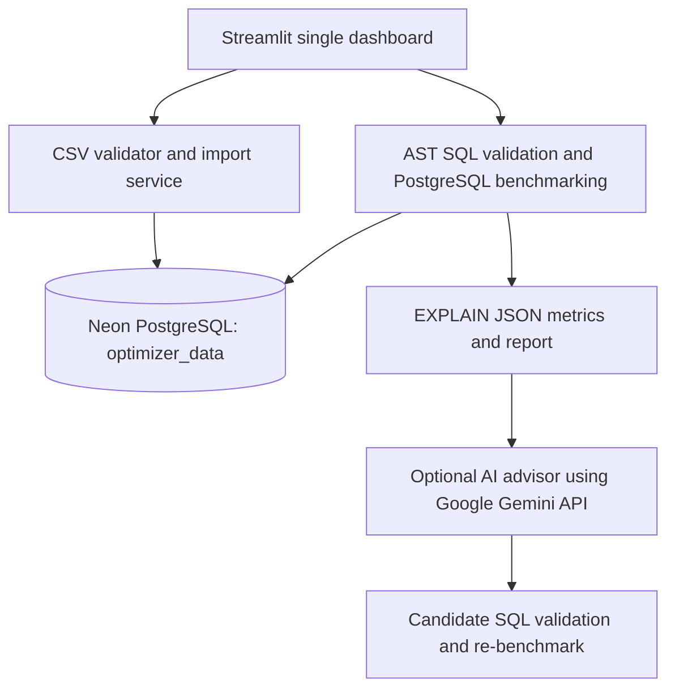

# SQL Query Optimizer

A **single-page Streamlit application** that imports a user's CSV into Neon PostgreSQL, benchmarks 2–5 user-written `SELECT` queries with real `EXPLAIN (ANALYZE, BUFFERS, FORMAT JSON)` measurements, and offers an **optional AI Optimization Advisor** that proposes a SQL rewrite and lets you benchmark it.

## Features

- CSV import (up to 10 MB, 50,000 rows, 50 columns), preview and inferred PostgreSQL types
- Multiple editable SQL queries; no canned experiments or seeded data
- Five-run, alternating-order PostgreSQL benchmarking with median, min/max, planning time and buffer statistics
- Execution-plan tree inspection and conservative performance insights
- AI suggestion (Google Gemini API) informed by SQL, schema, execution-plan nodes and real timings
- Explicit consent before sharing SQL/metadata; optional sample rows, off by default
- Benchmark the AI suggestion before accepting any improvement claim
- Download standalone HTML comparison report

## Local setup

1. Create a fresh Python virtual environment and install packages:

   ```bash
   python -m venv .venv
   source .venv/bin/activate  # Windows: .venv\\Scripts\\activate
   pip install -r requirements.txt
   ```

2. Copy `.env.example` to `.env`. Use a **separate Neon database** if you can. Do not reuse owner credentials for the application. For first-time setup, place your Neon owner connection in `ADMIN_DATABASE_URL` **temporarily** in `.env` (never commit it).
3. Review `scripts/provision.py`, then explicitly run:

   ```bash
   python scripts/provision.py
   python scripts/provision.py --apply
   ```

   This creates `optimizer_reader` and `optimizer_uploader` roles, dedicated `optimizer_data` schema, and appends the separate URLs to `.env`. The provisioning command will abort rather than overwrite a pre-existing role. After successful provisioning remove `ADMIN_DATABASE_URL` from `.env` and store owner credentials in a secure password manager.

4. Optional: set `GEMINI_API_KEY` and `GEMINI_MODEL` in `.env` for AI suggestions. Use a text-generation model. The advisor asks for JSON in the text response and validates it locally.

   The app loads `.env` from the project directory and keeps values already exported in the launching shell. Start it with `python -m streamlit run app.py` to use the same interpreter as your Python CLI checks. Restart Streamlit after changing `.env`. The generator and optimization advisor try `GEMINI_MODEL` first. Optionally set `GEMINI_FALLBACK_MODELS` to an ordered, comma-separated list of models available to your key. A fallback is used only after retries for HTTP 500 or 503. HTTP 429 stays on the current model and follows Google's retry guidance within a short wait limit. The dashboard identifies the responding model or shows a sanitized failure stage.

5. Run:

   ```bash
   streamlit run app.py
   ```

6. Tests:

   ```bash
   pytest -q
   ```

## Usage

Choose one or more CSVs in the same dashboard. Give each file a unique SQL table name and click its **Import dataset into PostgreSQL** button. Removing a file from the uploader leaves its imported table available. Expand a workspace table to inspect its schema, preview its first ten rows, or confirm its deletion. Use **Join keys and examples** to see columns with matching names and types. These hints require checking against your data.

Use 1 to 40 lowercase letters, digits, or underscores, starting with a letter. Reserved PostgreSQL keywords and internal names are unavailable. Separate sessions can reuse friendly names. Use `FROM customers`, `FROM optimizer_data.customers`, or an explicit alias. Qualify columns with the table name or alias, as in `customers.id` or `c.id`.

```sql
SELECT c.customer_id, sum(s.amount) AS total
FROM sales AS s
JOIN customers AS c ON c.customer_id = s.customer_id
GROUP BY c.customer_id;
```

Enter two or more queries and click **Analyze and compare**. PostgreSQL plan summaries identify join operators and their join types. To get a rewrite, consent to sharing benchmark and schema metadata, click **Ask AI to optimize**, then use **Test AI Query** to measure it before downloading the HTML report.

Use **AI SQL Generator** to draft a query in English. Gemini receives the question and workspace schema metadata. The app checks the returned SQL and binds its names using PostgreSQL's parse step without running the query. Review the assumptions and edit the draft in its own SQL editor. **Copy SQL** copies the current text. **Run Generated Query** explicitly executes the draft through the restricted reader and displays up to 100 rows in a separate preview. The generator leaves the comparison editors, benchmarks, and optimization advisor state alone.

If **Import dataset** is disabled, check that the project has a `.env` file with the provisioned `UPLOAD_DATABASE_URL`. Streamlit reads `.env` and environment variables. The `.env.example` file is a template. After updating the configuration, restart Streamlit.

## Architecture



### Security model and important limitations

- The uploader can create/delete tables in `optimizer_data` only; the reader has SELECT grants on imported tables, `default_transaction_read_only`, and application-level transaction read-only enforcement. Neither app role is intended to access the sample e-commerce tables.
- AST validation rejects modifying statements, admin SQL, most functions and references outside the active uploaded table. SQL still executes only as the restricted reader. Do not mistake parser checks for complete SQL security.
- **This is a local/single-user educational prototype.** Physical table names are randomly generated, but session state is not authorization. A shared read-only DB role can access other uploaded tables if their names are learned. Do not deploy to untrusted multiple users without real authentication, per-user privileges, database-enforced isolation, resource controls and a cleanup service.
- Importing another CSV leaves the existing workspace tables in place. Confirm deletion in an individual table panel to remove it. Closing a session can leave tables behind. Audit and remove stale `optimizer_data.ds_*` tables with a privileged administrator.
- Runtime measurements vary with cache state, background workload and dataset size; five runs do not guarantee statistical significance. Small CSV datasets may yield almost identical execution plans. SQL equivalence is **not** proven automatically.
- With consent, the advisor sends submitted SQL, bounded plan summaries, and schemas, sizes, possible join keys, and available index metadata for the relevant tables. Sharing up to ten rows from one selected table requires separate opt-in. SQL literals can contain sensitive information. Treat uploaded data as confidential and read your provider's data policies.
- Never upload secrets or personal information to a public instance. Keep `.env` outside Git.

## What it demonstrates

Python backend services, PostgreSQL DDL/DML separation, data ingestion with transactional COPY, SQL AST validation, PostgreSQL query plans, repeatable benchmarks, interactive visualization, optional AI integration and automated testing.
